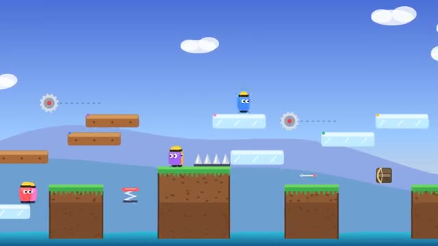

# Trap Builders

Build the level, then race it. Traps welcome. A multiplayer starter game from [Multiplayer Agent](https://multiplayeragent.com): 2D, party, 2–8 players, with bots that fill empty seats.

## How it plays

Each round everyone grabs a piece from the box (a platform, spikes, a spring, a saw, a crossbow or ice) and places it on the shared level. Then everyone races from the start to the flag. Reaching the flag scores points, with a bonus for getting there first or alone, and your traps score when they catch someone. A level everyone beats, or nobody beats, pays almost nothing, so build it hard but not impossible. The level keeps growing round after round; first to 15 points wins the match.

**Controls:** Mouse to place, arrows or A/D and Space to run and jump. On touch, tap to place and ◀ ▶ Jump to run.

## Make it yours in the Game Builder

Open the [Game Builder](https://multiplayeragent.com), choose **Start from a starter game** and pick Trap Builders. It opens as version 1 in your studio, ready to play and publish. Then ask for changes, for example:

- Add a bomb piece that blows up a piece already on the level
- Make the level a haunted castle with a lava floor
- Give points to the player whose trap catches the most people

## Run it yourself

1. Get a free publishable key (`pk_…`) at [multiplayeragent.com](https://multiplayeragent.com).
2. In `index.html`, put it in place of `pk_REPLACE_ME` in the `MP_CONNECT` block.
3. Open `index.html` in a browser. No build step and no server needed.

Without a key it still runs, offline against bots.

## How it is built

- One `index.html`. The comment at the top of the script maps the code and explains the multiplayer.
- The pieces live in `PIECES` and the starting level is drawn as text in `BASE`; the points for each result are in `CONFIG`.
- **Leaderboard:** The players who won the most matches.
- **Host-run rounds:** The host's browser deals the pieces, checks every placement, scores each run and starts the next round; if it leaves, the next player takes over.
- **Bots:** Bots pick pieces, set traps and race the level until enough people join.
- **Live sync:** Everyone sees the same level grow, and every ghost piece, runner and fall at once.
- `?attract` runs it offline with bots only. The preview video is recorded from it.

## License

MIT.
